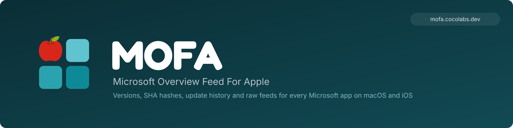
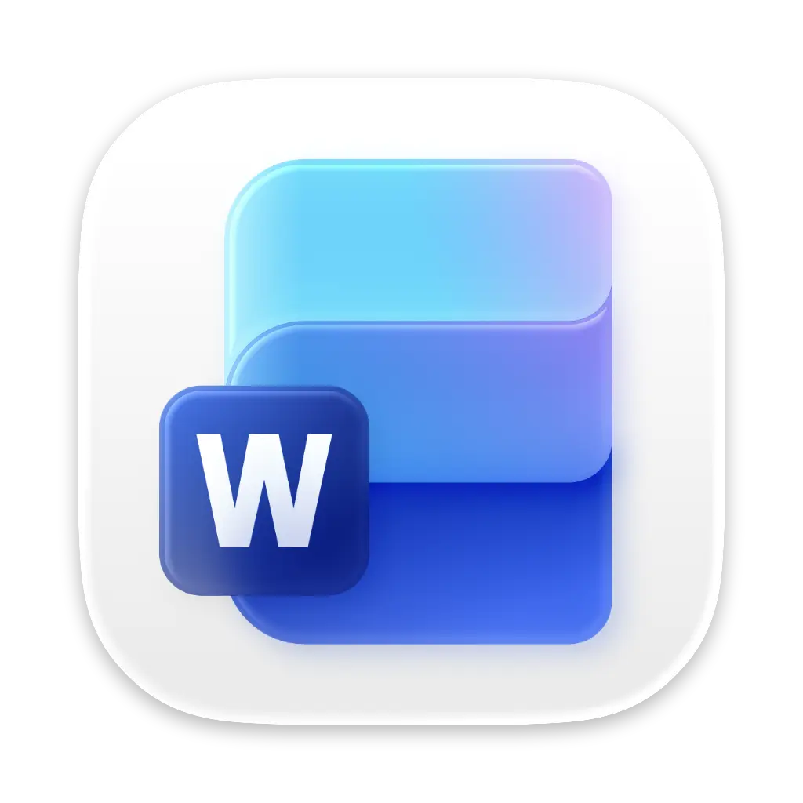
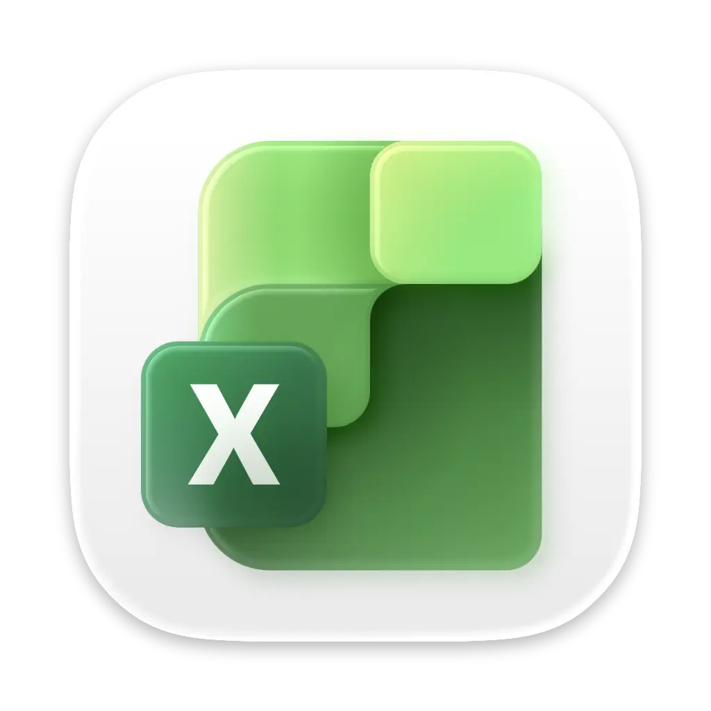
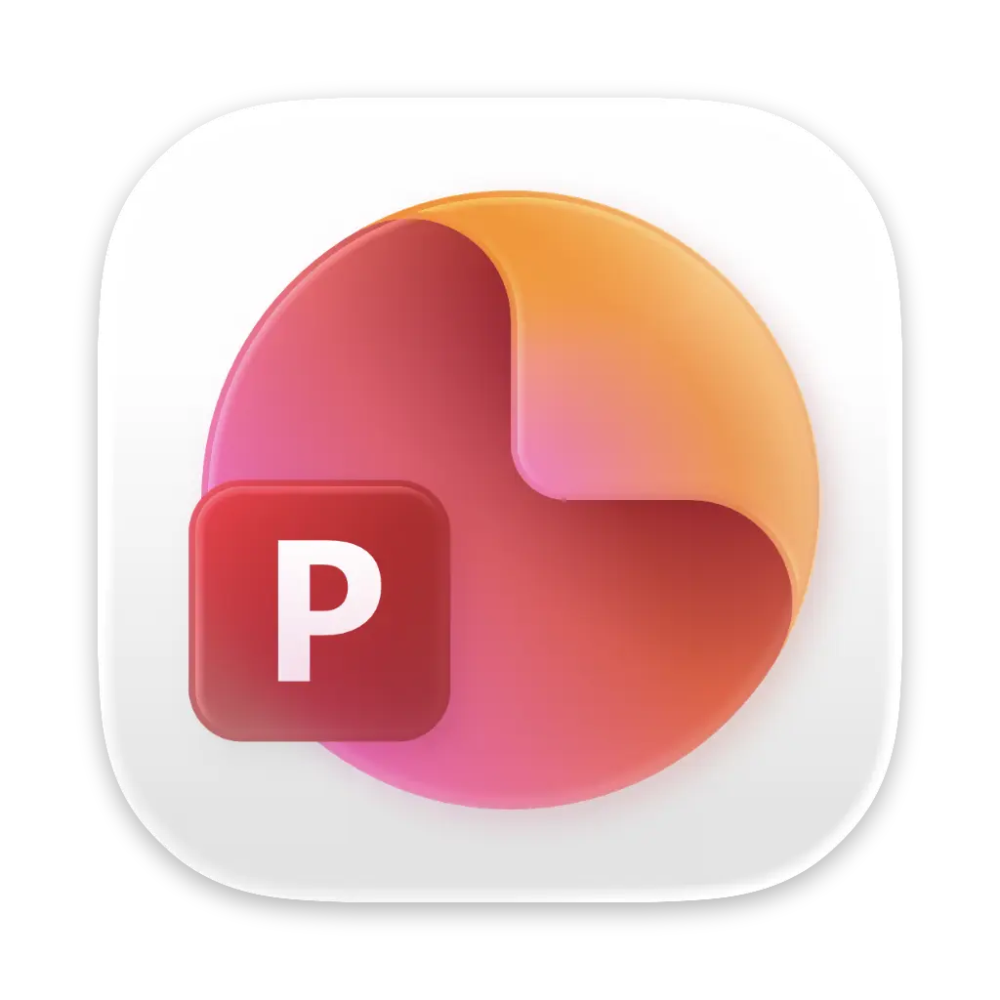
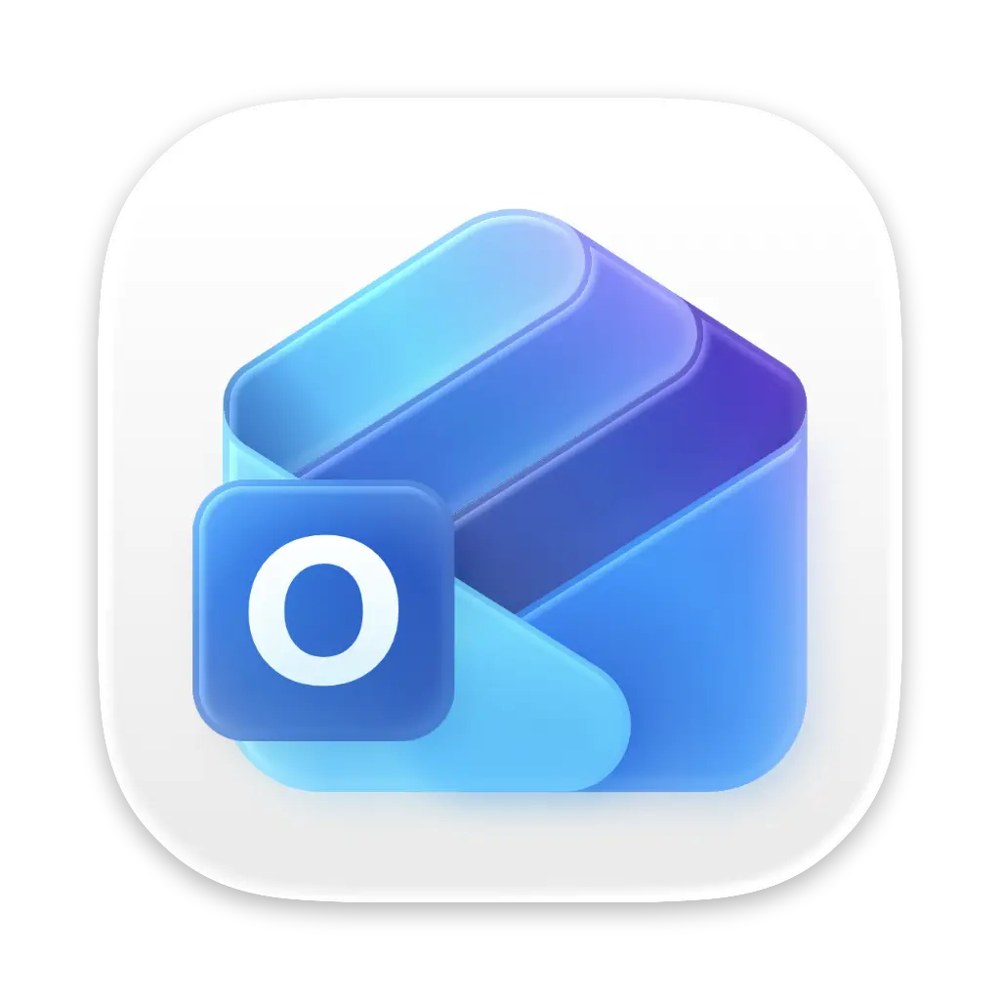
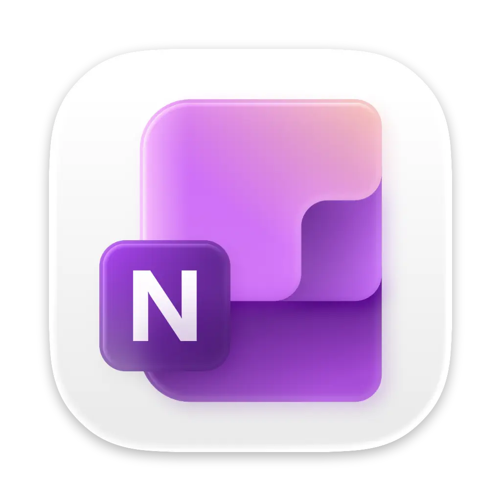
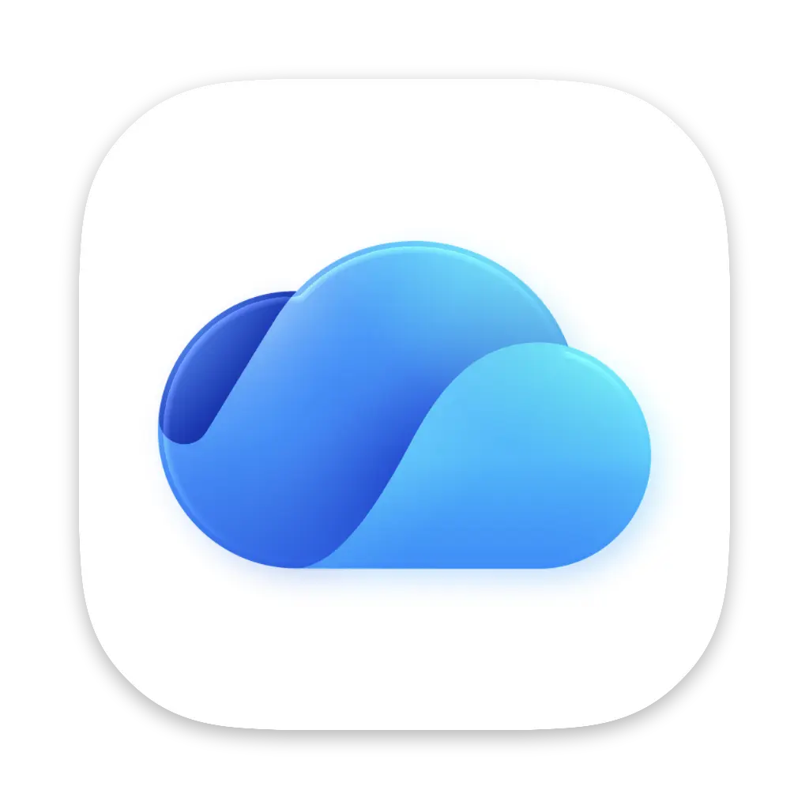
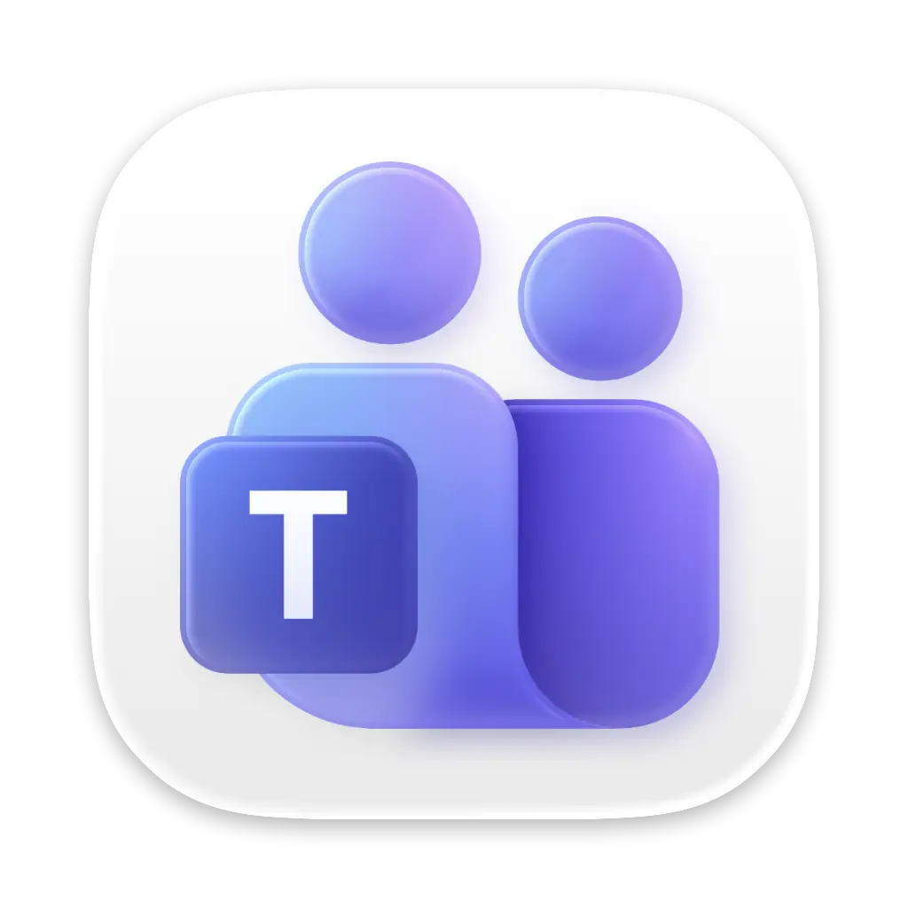
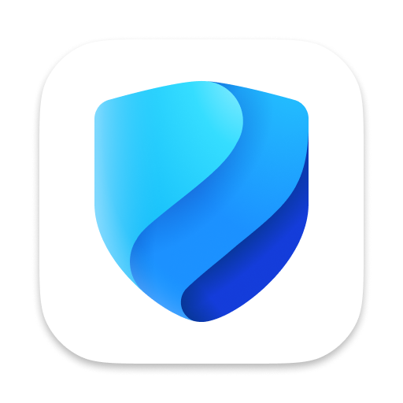
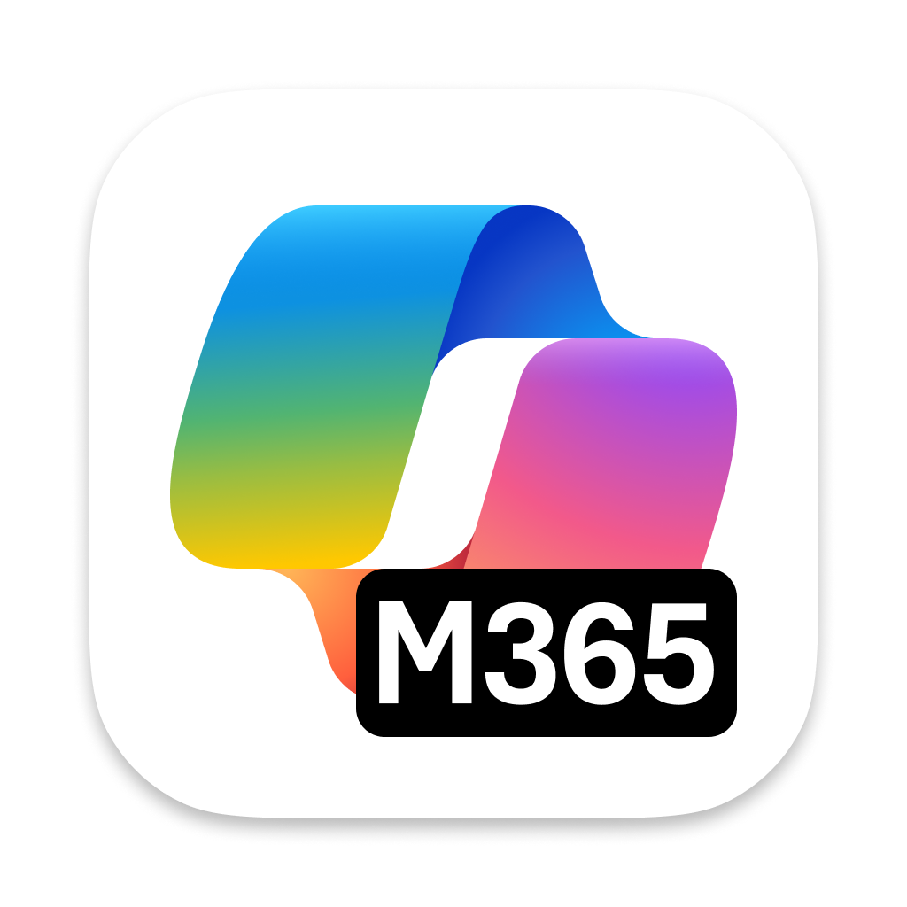

 

   

**MOFA** tracks every Microsoft app on macOS and iOS: current, preview and beta versions, SHA hashes, update and CVE history, and direct download links to Microsoft's CDN. Everything is scraped from Microsoft and Apple on a schedule and published here as XML, YAML and JSON, so you can read the tables below or point your own tooling at the feeds.

> **Prefer a website?** All of this, plus guides, configuration profiles and repair tools, is at **[mofa.cocolabs.dev](https://mofa.cocolabs.dev)**. The site is built from the same feeds, so it is never behind this README.

## What's in here

| Section | What you get | On the website |
|---|---|---|
| [Standalone packages](#standalone-packages) | Office, Teams, OneDrive, Edge, Defender, Intune, Windows App and more, with SHA256 hashes and the last builds for older macOS | [Current](https://mofa.cocolabs.dev/standalone_apps/standalone_current_version_en) · [Preview](https://mofa.cocolabs.dev/standalone_apps/standalone_preview_version_en) · [Beta](https://mofa.cocolabs.dev/standalone_apps/standalone_beta_version_en) · [Update history](https://mofa.cocolabs.dev/standalone_apps/standalone_update_history_en) · [CVE history](https://mofa.cocolabs.dev/standalone_apps/standalone_cve_history_en) |
| [Other Microsoft apps](#other-microsoft-apps) | PowerShell, .NET SDKs, Azure tooling, Bicep and sqlcmd | [Other apps](https://mofa.cocolabs.dev/standalone_apps/macos_standalone_other_readme) |
| [Mac App Store](#mac-app-store) | Versions and bundle IDs for Microsoft's Mac App Store apps | [Mac App Store](https://mofa.cocolabs.dev/macos_appstore/macos_appstore_current_version) |
| [iOS App Store](#ios-app-store) | Versions and bundle IDs for Microsoft's iOS apps | [iOS App Store](https://mofa.cocolabs.dev/ios_appstore/ios_appstore_current_version) |
| [Raw feeds](#raw-feeds) | Every dataset as XML, YAML and JSON, plus RSS | [Raw feeds](https://mofa.cocolabs.dev/standalone_apps/standalone_raw_feeds_en) |
| [Tools and guides](#tools-and-guides) | Repair tools, `.mobileconfig` profiles, preference keys, how-to guides | [MacOS Tools](https://mofa.cocolabs.dev/macos_tools/microsoft_office_repair_tools) |

## Raw feeds

Machine-readable copies of everything on this page live in [`latest_raw_files/`](latest_raw_files). Each dataset is written in three formats and refreshed on the schedule shown next to its table.

| Dataset | | | |
|---|---|---|---|
| Standalone packages, current | [<kbd>XML</kbd>](latest_raw_files/macos_standalone_latest.xml) | [<kbd>YAML</kbd>](latest_raw_files/macos_standalone_latest.yaml) | [<kbd>JSON</kbd>](latest_raw_files/macos_standalone_latest.json) |
| Standalone packages, preview | [<kbd>XML</kbd>](latest_raw_files/macos_standalone_preview.xml) | [<kbd>YAML</kbd>](latest_raw_files/macos_standalone_preview.yaml) | [<kbd>JSON</kbd>](latest_raw_files/macos_standalone_preview.json) |
| Standalone packages, beta | [<kbd>XML</kbd>](latest_raw_files/macos_standalone_beta.xml) | [<kbd>YAML</kbd>](latest_raw_files/macos_standalone_beta.yaml) | [<kbd>JSON</kbd>](latest_raw_files/macos_standalone_beta.json) |
| Office update history | [<kbd>XML</kbd>](latest_raw_files/macos_standalone_update_history.xml) | [<kbd>YAML</kbd>](latest_raw_files/macos_standalone_update_history.yaml) | [<kbd>JSON</kbd>](latest_raw_files/macos_standalone_update_history.json) |
| Office CVE history | [<kbd>XML</kbd>](latest_raw_files/mac_standalone_cve_history.xml) | [<kbd>YAML</kbd>](latest_raw_files/mac_standalone_cve_history.yaml) | [<kbd>JSON</kbd>](latest_raw_files/mac_standalone_cve_history.json) |
| Teams update history | [<kbd>XML</kbd>](latest_raw_files/teams_update_history.xml) | [<kbd>YAML</kbd>](latest_raw_files/teams_update_history.yaml) | [<kbd>JSON</kbd>](latest_raw_files/teams_update_history.json) |
| OneDrive, all rings | [<kbd>XML</kbd>](latest_raw_files/macos_standalone_onedrive_all.xml) | [<kbd>YAML</kbd>](latest_raw_files/macos_standalone_onedrive_all.yaml) | [<kbd>JSON</kbd>](latest_raw_files/macos_standalone_onedrive_all.json) |
| Edge, all channels | [<kbd>XML</kbd>](latest_raw_files/macos_standalone_edge_all.xml) | [<kbd>YAML</kbd>](latest_raw_files/macos_standalone_edge_all.yaml) | [<kbd>JSON</kbd>](latest_raw_files/macos_standalone_edge_all.json) |
| Other Microsoft apps | [<kbd>XML</kbd>](latest_raw_files/macos_other_latest.xml) | [<kbd>YAML</kbd>](latest_raw_files/macos_other_latest.yaml) | [<kbd>JSON</kbd>](latest_raw_files/macos_other_latest.json) |
| Mac App Store | [<kbd>XML</kbd>](latest_raw_files/macos_appstore_latest.xml) | [<kbd>YAML</kbd>](latest_raw_files/macos_appstore_latest.yaml) | [<kbd>JSON</kbd>](latest_raw_files/macos_appstore_latest.json) |
| iOS App Store | [<kbd>XML</kbd>](latest_raw_files/ios_appstore_latest.xml) | [<kbd>YAML</kbd>](latest_raw_files/ios_appstore_latest.yaml) | [<kbd>JSON</kbd>](latest_raw_files/ios_appstore_latest.json) |

RSS: one feed per standalone app in [`latest_raw_files/macos_standalone_rss/`](latest_raw_files/macos_standalone_rss). Links on the [website](https://mofa.cocolabs.dev/standalone_apps/standalone_raw_feeds_en#rss-feeds).

## Standalone packages

Direct links to Microsoft's CDN. A link always downloads the newest build Microsoft offers, so the version shown is the one available at the time of the last update.

🟢 Updated <code>November 13, 2026 07:49 AM EST</code>&nbsp;&nbsp;·&nbsp;&nbsp;Raw feed: <a href="latest_raw_files/macos_standalone_latest.xml"><kbd>XML</kbd></a> <a href="latest_raw_files/macos_standalone_latest.yaml"><kbd>YAML</kbd></a> <a href="latest_raw_files/macos_standalone_latest.json"><kbd>JSON</kbd></a>&nbsp;&nbsp;·&nbsp;&nbsp;refreshed every 1 hour

| **Product Package** | **Bundle Information** | **Download** |
|----------------------|----------------------|--------------|
| **Microsoft** 365/2021/2024 **Office Suite Installer** <a href="https://learn.microsoft.com/en-us/officeupdates/release-notes-office-for-mac" style="text-decoration: none;"><small>_Release Notes_</small></a> _(Includes Word, Excel, PowerPoint, Outlook, OneNote, OneDrive, Defender Shim, and MAU)_  _**Last Update:** `November 08, 2026`_  | **Version:** `16.115.0 (26110837)`  **Min OS:** `15.0`  **CFBundle ID:** `com.microsoft.office` |  |
| **Microsoft** 365/2021/2024 **BusinessPro Suite Installer** _(Includes Word, Excel, PowerPoint, Outlook, OneNote, OneDrive, Teams, Defender Shim, and MAU)_  _**Last Update:** `November 08, 2026`_  | **Version:** `16.115.0 (26110837)`  **Min OS:** `15.0`  **CFBundle ID:** `com.microsoft.office` |  |
| **Word** 365/2021/2024 **Standalone Installer**  _**Last Update:** `November 08, 2026`_  | **Version:** `16.115.0 (26110837)`  **Min OS:** `15.0`  **CFBundle ID:** `com.microsoft.word` |  |
| **Word** 365/2021/2024 **App Only Installer**  _(Does Not Contain MAU)_  _**Last Update:** `November 08, 2026`_  | **Version:** `16.115.0 (26110837)`  **Min OS:** `15.0`  **CFBundle ID:** `com.microsoft.word` |  |
| **Excel** 365/2021/2024 **Standalone Installer**  _**Last Update:** `November 08, 2026`_  | **Version:** `16.115.0 (26110837)`  **Min OS:** `15.0`  **CFBundle ID:** `com.microsoft.excel` |  |
| **Excel** 365/2021/2024 **App Only Installer**  _(Does Not Contain MAU)_  _**Last Update:** `November 08, 2026`_  | **Version:** `16.115.0 (26110837)`  **Min OS:** `15.0`  **CFBundle ID:** `com.microsoft.excel` |  |
| **PowerPoint** 365/2021/2024 **Standalone Installer**  _**Last Update:** `November 08, 2026`_  | **Version:** `16.115.0 (26110837)`  **Min OS:** `15.0`  **CFBundle ID:** `com.microsoft.powerpoint` |  |
| **PowerPoint** 365/2021/2024 **App Only Installer**  _(Does Not Contain MAU)_  _**Last Update:** `November 08, 2026`_  | **Version:** `16.115.0 (26110837)`  **Min OS:** `15.0`  **CFBundle ID:** `com.microsoft.powerpoint` |  |
| **Outlook** 365/2021/2024 **Standalone Installer**  _**Last Update:** `November 08, 2026`_  | **Version:** `16.115.0 (26110837)`  **Min OS:** `15.0`  **CFBundle ID:** `com.microsoft.outlook` | |
| **Outlook** 365/2021/2024 **App Only Installer**  _(Does Not Contain MAU)_  _**Last Update:** `November 08, 2026`_  | **Version:** `16.115.0 (26110837)`  **Min OS:** `15.0`  **CFBundle ID:** `com.microsoft.outlook` | |
| **OneNote** 365/2021/2024 **Standalone Installer**  _**Last Update:** `November 08, 2026`_  | **Version:** `16.115.0 (26110837)`  **Min OS:** `15.0`  **CFBundle ID:** `com.microsoft.onenote.mac` |  |
| **OneNote** 365/2021/2024 **App Only Installer**  _(Does Not Contain MAU)_  _**Last Update:** `November 08, 2026`_  | **Version:** `16.115.0 (26110837)`  **Min OS:** `15.0`  **CFBundle ID:** `com.microsoft.onenote.mac` |  |
| **OneDrive Standalone Installer** (Production Ring)  <a href="https://support.microsoft.com/en-us/office/onedrive-release-notes-845dcf18-f921-435e-bf28-4e24b95e5fc0#OSVersion=Mac" style="text-decoration: none;"><small>_Release Notes_</small></a>  _**Last Update:** `October 19, 2026 01:05 PM EDT`_  | **Version:** `26.173.0906`  **Min OS:** `NA`  **CFBundle ID:** `com.microsoft.OneDrive` |  |
| **Skype for Business Standalone Installer** <a href="https://support.microsoft.com/en-us/office/follow-the-latest-updates-in-skype-for-business-cece9f93-add1-4d93-9a38-56cc598e5781?ui=en-us&rs=en-us&ad=us" style="text-decoration: none;"><small>_Release Notes_</small></a>  _**Last Update:** `January 20, 2026`_  | **Version:** `16.31.0.31`  **Min OS:** `10.14.0`  **CFBundle ID:** `com.microsoft.SkypeForBusiness` |  |
| **Teams Standalone Installer** <a href="https://support.microsoft.com/en-us/office/what-s-new-in-microsoft-teams-d7092a6d-c896-424c-b362-a472d5f105de" style="text-decoration: none;"><small>_Release Notes_</small></a>  _**Last Update:** `October 26, 2026`_  | **Version:** `26289.204.5281.6363`  **Min OS:** `14.0`  **CFBundle ID:** `com.microsoft.teams2` |  |
| **InTune Company Portal Standalone Installer** <a href="https://aka.ms/intuneupdates" style="text-decoration: none;"><small>_Release Notes_</small></a>  _**Last Update:** `September 30, 2026`_  | **Version:** `5.2610.0`  **Min OS:** `11.0`  **CFBundle ID:** `com.microsoft.CompanyPortalMac` |  |
| **InTune Company Portal App Only Installer** <a href="https://aka.ms/intuneupdates" style="text-decoration: none;"><small>_Release Notes_</small></a> _(Does Not Contain MAU)_  _**Last Update:** `September 30, 2026`_  | **Version:** `5.2610.0`  **Min OS:** `11.0`  **CFBundle ID:** `com.microsoft.CompanyPortalMac` |  |
| **Edge** _(Current Channel)_ <a href="https://learn.microsoft.com/en-us/deployedge/microsoft-edge-relnote-stable-channel" style="text-decoration: none;"><small>_Release Notes_</small></a>  _**Last Update:** `November 12, 2026 07:51 PM EST`_  | **Version:** `157.0.4341.57`  **Min OS:** `11.0`  **CFBundle ID:** `com.microsoft.edgemac` | |
| **Defender for Endpoint Installer** <a href="https://learn.microsoft.com/microsoft-365/security/defender-endpoint/mac-whatsnew" style="text-decoration: none;"><small>_Release Notes_</small></a>  _**Last Update:** `October 28, 2026`_  | **Version:** `101.26092.0012`  **Min OS:** `14.0`  **CFBundle ID:** `com.microsoft.wdav` |  |
| **Defender for Consumers Installer** <a href="https://learn.microsoft.com/microsoft-365/security/defender-endpoint/mac-whatsnew" style="text-decoration: none;"><small>_Release Notes_</small></a>  _**Last Update:** `October 28, 2026`_  | **Version:** `101.26092.0012`  **Min OS:** `14.0`  **CFBundle ID:** `com.microsoft.wdav` |  |
| **Defender SHIM Installer**  _**Last Update:** `August 18, 2026`_  | **Version:** `101.26060.0000`  **Min OS:** `12.0`  **CFBundle ID:** `com.microsoft.wdav.shim` |  |
| **Windows App Standalone Installer** _(Remote Desktop )_ <a href="https://learn.microsoft.com/en-us/windows-app/whats-new?tabs=macos" style="text-decoration: none;"><small>_Release Notes_</small></a>  _**Last Update:** `November 07, 2026`_  | **Version:** `11.4.5`  **Min OS:** `15.0`  **CFBundle ID:** `com.microsoft.rdc.macos` |  |
| **Windows App Only Installer** _(Remote Desktop )_ <a href="https://learn.microsoft.com/en-us/windows-app/whats-new?tabs=macos" style="text-decoration: none;"><small>_Release Notes_</small></a> _(Does Not Contain MAU)_  _**Last Update:** `November 07, 2026`_  | **Version:** `11.4.5`  **Min OS:** `15.0`  **CFBundle ID:** `com.microsoft.rdc.macos` |  |
| **Visual Studio Code Standalone Installer** <a href="https://code.visualstudio.com/updates/" style="text-decoration: none;"><small>_Release Notes_</small></a>  _**Last Update:** `November 10, 2026`_  | **Version:** `1.146.0`  **Min OS:** `N/A`  **CFBundle ID:** `com.microsoft.VSCode` | |
| **Microsoft 365 Copilot** <a href="https://learn.microsoft.com/en-us/copilot/microsoft-365/release-notes?tabs=all" style="text-decoration: none;"><small>_Release Notes_</small></a> _(Transitioning into the Copilot app below)_  _**Last Update:** `October 23, 2026`_  | **Version:** `1.2610 (2101)`  **Min OS:** `14.0`  **CFBundle ID:** `com.microsoft.m365copilot` | |
| **Microsoft Copilot** _(Copilot App)_ <a href="https://support.microsoft.com/en-us/microsoft-365-copilot/the-microsoft-365-app-transition-to-the-microsoft-365-copilot-app" style="text-decoration: none;"><small>_Transition Notes_</small></a> _(Replaces Microsoft 365 Copilot; updated by EdgeUpdater, not MAU)_  _**Last Update:** `November 07, 2026`_  | **Version:** `157.0.4341.41`  **Min OS:** `13.0`  **CFBundle ID:** `com.microsoft.m365copilot` | |
| **AutoUpdate Standalone Installer** <a href="https://learn.microsoft.com/en-us/officeupdates/release-history-microsoft-autoupdate" style="text-decoration: none;"><small>_Release Notes_</small></a>  _**Last Update:** `September 17, 2026`_  | **Version:** `4.85 (26091737)`  **Min OS:** `12.0`  **CFBundle ID:** `com.microsoft.autoupdate` | |
| **Licensing Helper Tool Installer**  _**Last Update:** `September 10, 2023`_  | **Version:** `16.77.0 (23091003)`  **Min OS:** `11.0`  **CFBundle ID:** `com.microsoft.licensinghelper` | |
| **Quick Assist Installer**  _**Last Update:** `October 09, 2025`_  | **Version:** `1.0.2510032`  **Min OS:** `12.0`  **CFBundle ID:** `com.microsoft.quickassist` | |
| **Remote Help Installer**  _**Last Update:** `June 03, 2026`_  | **Version:** `1.0.2606021`  **Min OS:** `12.0`  **CFBundle ID:** `com.microsoft.remotehelp` | |

### SHA256 hashes

| **Product Package** | **Download** | **SHA256** |
|----------------------|-----------------|------------|
| **Microsoft Office Suite** |  | `a369175b71789692d864034e746cbaa79fb3b7c05549a9904111a8302ffd54b7` |
| **Microsoft BusinessPro Suite** |  | `1547112b2d8d59297a56fedf5616f4a92dfbe9a928b13f4aa0628532a63a95c4` |
| **Word Standalone** |  | `5db08593bc098f70e02cd2c4a2d0b5a724bb0cae6bc4da26bf208eb716717c2d` |
| **Word App Only** |  | `52eacead463290f2033afb12535e64c0ae4d48eaa331bd1d4ccea4ecaa3f4a22` |
| **Excel Standalone** |  | `de94b56243d96210c65188fc6d23dc0e1614d6746765c14584e6451b61607eff` |
| **Excel App Only** |  | `a8c364ab436e91502d3bf810e15d4af33f1ce42ea9ed57d0e5b108df71bf6ba4` |
| **PowerPoint Standalone** |  | `3178997f7a53596d2902833d6878dd5b594d3345025c64b83159dfcc93962334` |
| **PowerPoint App Only** |  | `dccbb051d28351588da06397c2b1450ffeac0a517238399db98cd160d0f84fd1` |
| **Outlook Standalone** |  | `937f527f7cad94bc32025e82cf9cbb3601a9b4e2f4f30ff83be7f72a028f460e` |
| **Outlook App Only** |  | `937f527f7cad94bc32025e82cf9cbb3601a9b4e2f4f30ff83be7f72a028f460e` |
| **OneNote Standalone** |  | `b3285547848c084afb6ffec4f1e374b12e6225ff6d6824f802079e516707fbb3` |
| **OneNote App Only** |  | `b3285547848c084afb6ffec4f1e374b12e6225ff6d6824f802079e516707fbb3` |
| **OneDrive** |  | `cc0270130dc32cf92d27a52a145639a6cbbf0e88287a1b5603be4292af9da66a` |
| **Skype for Business** |  | `891dbba7518645642e6bfe4287071b984830994c528fad82490b4df6b14e4312` |
| **Teams** |  | `bd029c2023a943dc76c9a03410c91f06d8b92c07115daf9763d5b9475aaba87c` |
| **Intune Company Portal Standalone** |  | `6e64ca365fce10bb5927bebf71ec0d13a223bb50b8e95d2550a3be0352ab2b55` |
| **Intune Company Portal App Only** |  | `9c1d00eb77e807448181ae23c08413f2a8bcad55943c69efad732d80a809046e` |
| **Edge** |  | `d2791ba64c1c40332fdd6b21e26a5b58cc2ce002f4b9dc5dd6445ab500ce2798` |
| **Defender for Endpoint** |  | `f7ee0f5491380336d93f4a33e8907d25cc51459d888e6fe0642796fa348fe7e3` |
| **Defender for Consumers** |  | `58448d6b845b23ee83881a92e8eaa5508c381371a6922066ef1c4b4a38829adf` |
| **Defender SHIM** |  | `8914d9f0cd511e134617d08d3bcbf01df96fd08b1ca34b5dc912d27a54aa3c6c` |
| **Windows App Standalone** |  | `70041210ec1c40cbcc1913010fb9a7de7e2b0c8d9f336777775789ae65bc9cab` |
| **Windows App Only** |  | `5d3ae5fb93f61a561384f1339dae147c17a8e6d31f6871660f180c9b39e41e2a` |
| **Visual Studio Code** |  | `1ca22eafb3350775b99f13f8f726c5335043a04094107fca0be888a4ebb3a3bf` |
| **Microsoft 365 Copilot** |  | `0fea044825f482ebce9f7308fc77ac99b0ff2718d7bfa4e43db59dfe621d4632` |
| **Microsoft Copilot** _(Copilot App)_ |  | `d2eef0283791badd3f67684d1b70e4c4a18e6a9fc63570cc9e11d773ef2ed6a6` |
| **AutoUpdate** |  | `be878237348c79d03c6a8286e7b61c58265d9cc5917d1a282c25059fe46bd4a7` |
| **Licensing Helper Tool** |  | `2ef5b5006534c0d20d46c7353f42a0dc1faff7d53ba89a3151ccf5102c059905` |
| **Quick Assist** |  | `294bed3d1cab280056ff20b22c65486381c976b10c1e4e2ae9559404484ec55a` |
| **Remote Help** |  | `686c9fe7b54ff006b574653abc2fe616afe9244d561d5bd9fd84a99971a8c423` |

Verify a download with <code>shasum -a 256 /path/to/file.pkg</code> and compare it to the table. Guide: [How to SHA256](guides/How_To_SHA256.md). Apps without their own release notes follow the Office suite's. SHA1 and preview/beta hashes are on the [website](https://mofa.cocolabs.dev/standalone_apps/standalone_sha256_hashes_en).

### Last supported versions

The final build of the Office suite for each macOS that Microsoft no longer supports.

| **Last Supported MacOS** | **File Name** | **Version** | **Download** |
|---------------------------|----------------|-------------|--------------|
| macOS 13 Ventura  | Microsoft Office Suite Installer | `16.101` |  |
| macOS 13 Ventura  | Microsoft BusinessPro Suite Installer| `16.101` |  |
| macOS 12 Monterey  | Microsoft Office Suite Installer | `16.88` |  |
| macOS 12 Monterey  | Microsoft BusinessPro Suite Installer| `16.88` |  |
| macOS 11 Big Sur  | Microsoft Office Suite Installer | `16.77` |  |
| macOS 11 Big Sur  | Microsoft BusinessPro Suite Installer| `16.77` |  |
| macOS 10.15 Catalina  | Microsoft Office Suite Installer | `16.66` |  |
| macOS 10.15 Catalina  | Microsoft BusinessPro Suite Installer| `16.66` |  |

Related:     <a href="https://learn.microsoft.com/en-us/microsoft-365-apps/updates/overview-update-channels"><kbd>Microsoft update channels</kbd></a>

## Other Microsoft apps

Microsoft tools outside the Office suite, from GitHub releases, Microsoft's CDN or Homebrew. Some are Homebrew-only; the versions below are the latest official releases.

🟢 Updated <code>November 13, 2026 07:50 AM EST</code>&nbsp;&nbsp;·&nbsp;&nbsp;Raw feed: <a href="latest_raw_files/macos_other_latest.xml"><kbd>XML</kbd></a> <a href="latest_raw_files/macos_other_latest.yaml"><kbd>YAML</kbd></a> <a href="latest_raw_files/macos_other_latest.json"><kbd>JSON</kbd></a>&nbsp;&nbsp;·&nbsp;&nbsp;refreshed every 4 hours

| **Product Package** | **Bundle Information** | **Download** |
|----------------------|----------------------|--------------|
| **PowerShell**  _**Last Update:** `November 10, 2026`_  | **Version:** `7.7.0` |  |
| **.NET SDK 10 (LTS)**  _**Last Update:** `November 10, 2026`_  | **Version:** `10.0.404` |  |
| **.NET SDK 11 (STS)**  _**Last Update:** `November 10, 2026`_  | **Version:** `11.0.100` |  |
| **.NET SDK 9 (STS)**  _**Last Update:** `November 10, 2026`_  | **Version:** `9.0.321` |  |
| **.NET SDK 8 (LTS)**  _**Last Update:** `November 10, 2026`_  | **Version:** `8.0.428` |  |
| **Azure Functions Core Tools**  _**Last Update:** `October 12, 2026`_  | **Version:** `4.16.0` |  |
| **Azure Developer CLI (azd)**  _**Last Update:** `November 12, 2026`_  | **Version:** `1.1.0` |  |
| **AzCopy**  _**Last Update:** `October 22, 2026`_  | **Version:** `10.34.1` |  |
| **Bicep CLI**  _**Last Update:** `November 06, 2026`_  | **Version:** `0.49.2` |  |
| **Azure CLI**  _**Last Update:** `September 01, 2026`_  | **Version:** `2.90.0` |  `brew install azure-cli` |
| **sqlcmd**  _**Last Update:** `March 03, 2026`_  | **Version:** `1.10.0` |  `brew install sqlcmd` |

### SHA256 hashes

| **Product Package** | **Download** | **SHA256** |
|----------------------|-----------------|------------|
| **PowerShell** |  | `a15e395a9749b67501e69e52e07ef53bbb39ed2c97ed18940d5497e9c0e49a2e` |
| **.NET SDK 10 (LTS)** |  | `2e0637ae0448bd8e3615cf31e0ad2a6dcb3fa0d3a78873f98fb1d25b39e858d6` |
| **.NET SDK 11 (STS)** |  | `96b96a7d7ec00b2397d575ffa7acfe685d7261fe2a2719d80131e5f8003deaf9` |
| **.NET SDK 9 (STS)** |  | `3deea6ed3ea001fbd279783297cbdbf6c43c3ded3f5da61c7e44c8951fd4e2b0` |
| **.NET SDK 8 (LTS)** |  | `a6a302b95ef39c6ea753df6514195b604d7d8ecd5b99f955295dd8a35f05dbbd` |
| **Azure Functions Core Tools** |  | `5698d54038fd0507a614af53e8bd3f91c89f96e60ae081c113373b3d2af375f3` |
| **Azure Developer CLI (azd)** |  | `6bf09ea5cf4c2bfa63c0e8c5d0b14eae8e07616b07adf2a45013032587586ebd` |
| **AzCopy** |  | `44f5e72f663215f838c6ccedf6da9f0fbc9ee7215610bf88b92b1bfa931e5524` |
| **Bicep CLI** |  | `8ae74a6cf9cbba0cb220c40cf0e955f98d59df950afab07c21b7bcb78c9c5d68` |

## Mac App Store

🟢 Updated <code>November 13, 2026 07:49 AM EST</code>&nbsp;&nbsp;·&nbsp;&nbsp;Raw feed: <a href="latest_raw_files/macos_appstore_latest.xml"><kbd>XML</kbd></a> <a href="latest_raw_files/macos_appstore_latest.yaml"><kbd>YAML</kbd></a> <a href="latest_raw_files/macos_appstore_latest.json"><kbd>JSON</kbd></a>&nbsp;&nbsp;·&nbsp;&nbsp;refreshed every 4 hours

| **Application Name** | **Version** | **Bundle ID** | **Icon** |
|----------------------|-------------|---------------|----------|
| Microsoft Word | `16.115` | `com.microsoft.Word` |  |
| Microsoft Excel | `16.115` | `com.microsoft.Excel` |  |
| Microsoft PowerPoint | `16.115` | `com.microsoft.Powerpoint` |  |
| Microsoft Outlook | `16.115` | `com.microsoft.Outlook` |  |
| Microsoft OneNote | `16.115` | `com.microsoft.onenote.mac` |  |
| OneDrive | `26.189.0928` | `com.microsoft.OneDrive-mac` |  |
| Xiaomi Interconnectivity | `3.1.1` | `com.xiaomi.hyperConnect` |  |
| Windows App | `11.4.5` | `com.microsoft.rdc.macos` |  |
| Microsoft To Do | `2.177` | `com.microsoft.to-do-mac` |  |
| Copilot: Track & Budget Money | `8.7.2` | `com.copilot.production` |  |
| Azure VPN Client | `3.0.100` | `com.microsoft.AzureVpnMac` |  |
| Universal Print | `1.1.1` | `com.microsoft.universalprintmac` |  |
| Microsoft Rewards for Safari | `1.0.0` | `com.microsoft.Microsoft-Rewards-for-Safari` |  |
| Microsoft Bing for Safari | `3.0.0` | `com.microsoft.MicrosoftBingSearch` |  |
| Microsoft Accessory Updater | `1.2` | `com.microsoft.Microsoft-Accessory-Firmware-Updater` |  |

## iOS App Store

🟢 Updated <code>November 13, 2026 07:49 AM EST</code>&nbsp;&nbsp;·&nbsp;&nbsp;Raw feed: <a href="latest_raw_files/ios_appstore_latest.xml"><kbd>XML</kbd></a> <a href="latest_raw_files/ios_appstore_latest.yaml"><kbd>YAML</kbd></a> <a href="latest_raw_files/ios_appstore_latest.json"><kbd>JSON</kbd></a>&nbsp;&nbsp;·&nbsp;&nbsp;refreshed every 4 hours

| **Application Name** | **Version** | **Bundle ID** | **Icon** |
|----------------------|-------------|---------------|----------|
| Microsoft Word | `2.115.3` | `com.microsoft.Office.Word` |  |
| Microsoft Excel | `2.115.3` | `com.microsoft.Office.Excel` |  |
| Microsoft PowerPoint | `2.115.3` | `com.microsoft.Office.Powerpoint` |  |
| Microsoft Outlook | `5.2644.0` | `com.microsoft.Office.Outlook` |  |
| Microsoft OneNote | `16.115.3` | `com.microsoft.onenote` |  |
| Microsoft OneDrive | `26.1.4` | `com.microsoft.skydrive` |  |
| Windows App Mobile | `11.4.1` | `com.microsoft.rdc.ios` |  |
| Microsoft Defender: Security | `1.1.82260102` | `com.microsoft.scmx` |  |
| Microsoft Copilot | `2.116` | `com.microsoft.officemobile` |  |
| Microsoft Loop | `2.115` | `com.microsoft.loop` |  |
| Microsoft Warehouse Management | `4.2.2` | `com.microsoft.WarehouseManagement` |  |
| Store Commerce | `9.59.26310` | `com.microsoft.storecommerce` |  |
| Dynamics 365 Sales | `3.26073.4` | `com.microsoft.dynamics.iphone.moca.sales` |  |
| Microsoft SharePoint | `6.2.0` | `com.microsoft.sharepoint` |  |
| Dynamics 365 Field Service | `13.26082.8` | `com.microsoft.dynamics.iphone.moca.fieldServices` |  |
| Viva Engage | `11.64.0` | `wefwef` |  |
| Whiteboard: just draw together | `2.8.2` | `com.jimschultz.WhiteBoard` |  |
| Microsoft Edge | `157.4341.42` | `com.microsoft.msedge` |  |
| Seeing AI | `5.6.1` | `com.microsoft.seeingai` |  |
| Microsoft Planner | `1.17.19` | `com.microsoft.PlannerMobile` |  |
| Microsoft Azure | `8.1.13` | `com.microsoft.azure` |  |
| Microsoft To Do | `2.177` | `com.microsoft.to-do` |  |
| Microsoft Teams | `8.20.0` | `com.microsoft.skype.teams` |  |
| Microsoft SharePoint | `6.2.0` | `com.microsoft.sharepoint` |  |
| Dynamics 365 Business Central | `4.6.11041` | `com.microsoft.dynamics.ProjectMadeira` |  |
| Power Apps | `3.26103.23` | `com.microsoft.msapps` |  |
| Microsoft Authenticator | `6.8.58` | `com.microsoft.azureauthenticator` |  |
| Google Ads | `3.43.20092307` | `com.google.AdWords` |  |
| Lens - PDF Scanner and Editor | `1.4.4` | `com.Scantera593thzp.app` |  |
| Work Folders | `2.2.0` | `com.microsoft.workfolders` |  |
| Microsoft Power BI | `38.7` | `com.microsoft.powerbimobile` |  |
| Microsoft 365 Admin | `6.1.0` | `com.microsoft.o365shdmobileapp` |  |
| Intune Company Portal | `5.2610.0` | `com.microsoft.CompanyPortal` |  |
| Microsoft Azure | `8.1.13` | `com.microsoft.azure` |  |
| Microsoft Copilot | `2.116` | `com.microsoft.officemobile` |  |
| Skype for Business | `6.34.119` | `com.microsoft.lync2013.iphone` |  |

## Tools and guides

These moved to the website, where they are easier to browse and kept current. The source files still live in this repository.

| | |
|---|---|
| **[Office repair tools](https://mofa.cocolabs.dev/macos_tools/microsoft_office_repair_tools)** | Reset and repair scripts for Office, Outlook, OneDrive, Teams and friends, including the archived Office Reset packages in [`office_reset_tools/`](office_reset_tools). |
| **[Community scripts](https://mofa.cocolabs.dev/macos_tools/community_scripts)** | Scripts shared by Mac admins for installing, updating and troubleshooting Microsoft apps. |
| **[Configuration profiles](https://mofa.cocolabs.dev/macos_tools/preconfigured_profiles)** | Ready-to-deploy `.mobileconfig` files for Microsoft AutoUpdate deadlines and privacy prompts. Source in [`mobileconfig_profiles/`](mobileconfig_profiles). |
| **[Preference keys](https://mofa.cocolabs.dev/macos_tools/profile_breakdown)** | How Office plist keys work, with the community preference list and Microsoft's documentation. |
| **Guides** | [How to plist](guides/How_To_plist.md) · [How to SHA256](guides/How_To_SHA256.md) |

## Get involved

MOFA is built in the open by Mac admins, for Mac admins. You don't need to be a developer to help.

| | |
|---|---|
| 🐛 **[Report an issue](https://github.com/cocopuff2u/MOFA/issues)** | A wrong version, a dead link, a missing app. Issues are the fastest way to get it fixed. |
| 💡 **[Suggest something](https://github.com/cocopuff2u/MOFA/discussions)** | New feeds, new apps to track, or anything that would make MOFA more useful. |
| 🔀 **Send a pull request** | Fork the repo, make your change and open a PR. The generators live in [`.github/actions/`](.github/actions). |
| 💬 **[Mac Admins Slack](https://macadmins.org/slack)** | Say hi to `cocopuff2u`, or join `#microsoft-office`, `#microsoft-autoupdate`, `#microsoft-intune`, `#microsoft-windows-app` and `#microsoft-teams`. |
| ⭐ **[Star the repo](https://github.com/cocopuff2u/MOFA)** | It helps other admins find the project. |
| ☕ **[Buy me a coffee](https://www.buymeacoffee.com/cocopuff2u)** | Covers the domain and hosting; anything left over goes back to the Mac Admins community. |

## Thanks

MOFA picks up where the much-missed [MacAdmins.software](https://macadmins.software) left off. Special thanks to [Paul Bowden](https://github.com/pbowden-msft) for years of exceptional work for the Mac Admins community, and to everyone who has [contributed](https://mofa.cocolabs.dev/about_support/team) since.

Useful background reading: [Microsoft versioning explained](https://macmule.com/2018/09/24/microsoft-office-for-mac-changes-versioning-shenanigans/) · [Deployment options for Office for Mac](https://learn.microsoft.com/en-us/microsoft-365-apps/mac/deployment-options-for-office-for-mac) · [Deploying from the Mac App Store](https://learn.microsoft.com/en-us/microsoft-365-apps/mac/deploy-mac-app-store) · [Jamf: managing Microsoft Office](https://learn.jamf.com/en-US/bundle/technical-paper-microsoft-office-current/page/User_Experience_Configuration.html)

Microsoft 365, Office 365, Excel, PowerPoint, Outlook, OneDrive, OneNote, Teams and Edge are trademarks of Microsoft Corporation. Mac, macOS and iOS are trademarks of Apple Inc. Other names and brands may be claimed as the property of their respective owners. MOFA is a community project and is not affiliated with Microsoft or Apple.
